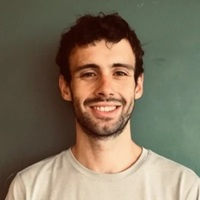

I’m an assistant professor at the [Wageningen University in the Netherlands](https://www.wur.nl/en/) and guest Researcher at the Lab “Societal Transition and Well-Being and Development” at the [Potsdam Institute For Climamate Impact Research in Germany](https://www.pik-potsdam.de). Prior to coming to the Netherlands, I was Postdoctoral Researcher at [Technical University of Berlin](https://www.tu.berlin/en/). I received a PhD in Economics **Cum Laude** from the [Universitat Autònoma de Barcelona (UAB)](https://www.uab.cat/web/universitat-autonoma-de-barcelona-1345467954774.html) in 2021.

I study [WHATEVER](), and I got in 2021 an **Honorable mention** as part of [Emerging Scholar Dissertation Award](https://www.eaere.org/best-european-doctoral-dissertation-award/) from the [European Association of Environmental and Resource Economists (EAERE)](https://www.eaere.org/). I do research in WHATEVER.

I teach courses on WHATEVER.
